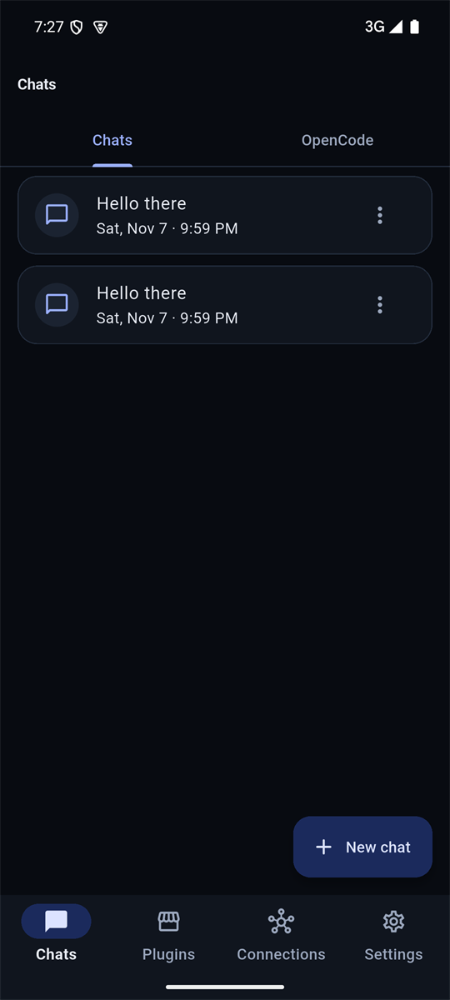
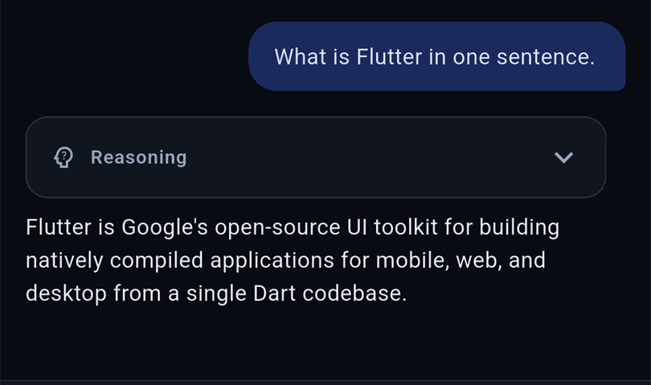
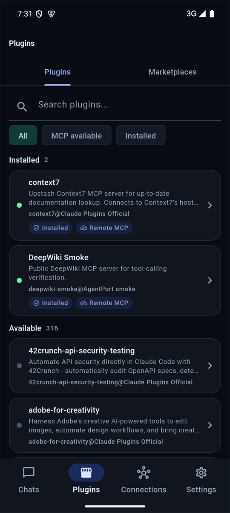
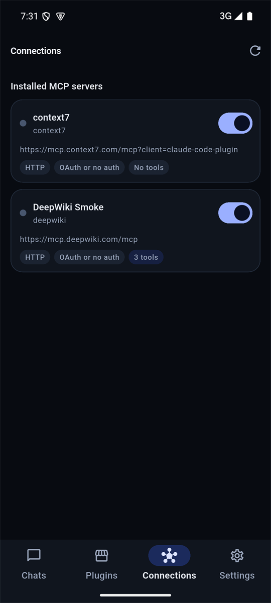
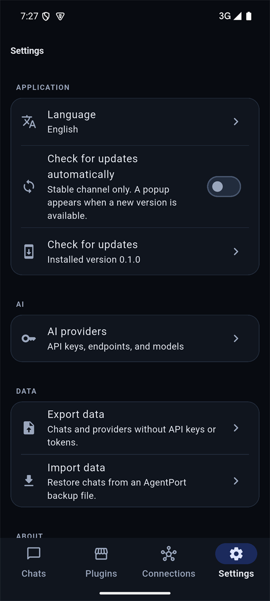

# AgentPort

**Android AI chat client with MCP connectors and remote control for [OpenCode](https://opencode.ai).**

[](https://github.com/IWatman/AgentPort/actions/workflows/ci.yml)
[](https://github.com/IWatman/AgentPort/releases/latest)
[](LICENSE)


AgentPort is a local-first Android app for chatting with AI models using your own API key, connecting remote MCP servers, and controlling OpenCode sessions from your phone.

> **Status:** `v0.2.1` is the latest stable release.

## Contents

- [Screenshots](#screenshots)
- [Features](#features)
- [Install](#install)
- [OpenCode](#opencode)
- [MCP marketplace](#mcp-marketplace)
- [Providers](#providers)
- [Security and privacy](#security-and-privacy)
- [Build from source](#build-from-source)
- [Tech stack](#tech-stack)
- [Releases](#releases)
- [Documentation](#documentation)
- [Limitations](#limitations)
- [Contributing](#contributing)
- [License](#license)

## Screenshots

<p align="center">
  
  
  
</p>
<p align="center">
  
  
</p>

## Features

### Chat

- DeepSeek and any OpenAI-compatible API with your own key.
- Presets for DeepSeek, OpenAI, OpenRouter, Groq, Mistral, Together AI, xAI, and Google Gemini.
- Streaming replies, stop and retry, Markdown and code blocks.
- Photos, text-file attachments, voice input, and per-conversation model selection.
- Reasoning cards stay collapsed by default.
- One-tap scroll to the true bottom of a long transcript.

### MCP connectors

- Browse Claude-compatible plugin marketplaces and install remote MCP servers.
- Google Workspace presets for Calendar, Gmail, Drive, Docs, Sheets, Slides, Chat, People, and Classroom; paste one Google Cloud OAuth client and select the services you need.
- Streamable HTTP and legacy HTTP+SSE transports over HTTPS.
- Browser OAuth with discovery, dynamic registration, Authorization Code + PKCE, a loopback callback, and automatic token refresh.
- Pre-registered OAuth clients with fixed redirect URIs, custom scopes, and extra authorization parameters for providers such as Google.
- Manual API key or header authorization as a fallback.
- Tool calls in chat: read-only tools run automatically, write tools ask for approval, and a turn is capped at four tool rounds.

### OpenCode remote control

- Pair by QR code or URL; connect over LAN, a tunnel, or a remote host.
- Browse projects, create a project with a remote folder browser, and list only that project's sessions; search all sessions by title, directory, or ID.
- Grouped transcripts: hidden reasoning behind a psychology button, one **Used N** tool summary, then the final answer.
- Slash commands, `@` project-file mentions, image and file attachments.
- Agent, model, and model-variant switching; token, cost, and context details.
- Session context sheet with current context usage, session totals, cost including subagents, timestamps, message counts, and the latest system prompt.
- Extensions sheet with MCP server status and connect/disconnect switches, plugins, and searchable skills.
- OpenCode permission prompts can be answered from the phone with allow-once, always-allow, or deny.
- Live SSE updates, automatic reconnect, and refresh when another client changes the session.

### Data and updates

- SQLCipher-encrypted chats and local data.
- API keys and tokens in the Android Keystore, never in the database.
- Export and import chats/providers without secrets.
- Daily and on-demand stable update checks with release notes, download progress, SHA-256 verification, and the Android installer.
- English and Russian UI.

## Install

1. Download the latest APK from [GitHub Releases](https://github.com/IWatman/AgentPort/releases/latest).
2. Verify the SHA-256 checksum if needed.
3. Allow installation from your browser or file manager on Android.
4. Open AgentPort and complete onboarding.

Requirements: **Android 8.0 (API 26) or newer**. Releases from GitHub are signed with the project release key; future updates must use the same signature.

## OpenCode

On the computer:

```bash
opencode service set password 'strong-password'
opencode service start
opencode pair
```

In AgentPort, open **Chats → OpenCode → Pair**. Scan the QR code or enter the server URL and password manually. For a remote connection, use `opencode pair --remote` or pass a custom URL:

```bash
opencode pair --url https://your-host
```

After pairing, open the connection to browse projects and sessions. Use **New project** to browse folders on the OpenCode host and register one as a project. The session screen streams live output and supports prompts, stop, commands, mentions, agent/model switching, session context, and extensions.

Minimum supported OpenCode version: **2.2.5**. The OpenCode v2 API is experimental. See [docs/OPENCODE.md](docs/OPENCODE.md) for the full support matrix and remaining API capabilities.

## MCP marketplace

The official Anthropic marketplace, `anthropics/claude-plugins-official`, is seeded on first launch and cannot be deleted. Its catalog is cached locally after the first sync and refreshed on first use if the cache is older than 24 hours. Custom marketplace catalogs are cached too.

The Marketplace screen has two tabs:

- **Plugins** — search and filter by **All**, **MCP available**, or **Installed**.
- **Marketplaces** — refresh sources or add one with `owner/repo`, a GitHub URL, or a direct `marketplace.json` URL.

GitHub marketplaces keep their manifest at `.claude-plugin/marketplace.json`. After a catalog sync, AgentPort checks each plugin's `.mcp.json` in the background and caches the result.

Only remote MCP servers over HTTPS are supported on Android. The Plugins tab hides plugins that cannot run on a phone: local `stdio`/command servers, plugins without a remote MCP server, and plugins with an unresolved or failed compatibility check. Installed plugins stay visible so they can be managed or removed. Install state is stored locally; if a plugin's MCP configuration changes, it is disabled until the new configuration is reviewed and accepted.

### Google Workspace

Open **Connections → Add Google Workspace**. The screen accepts a Google Cloud OAuth client ID and secret, shows the exact redirect URI, and creates a separate MCP connection for each selected service. The built-in instructions cover the Workspace Developer Preview, the APIs and MCP services to enable, the OAuth consent screen, and the **Use this client for an AI-powered agent** requirement.

Google Workspace MCP servers are in Developer Preview and require access to the Google Workspace Developer Preview Program. A Desktop app OAuth client is recommended; a Web application client also works after adding `http://127.0.0.1:53682/callback` to its authorized redirect URIs. The OAuth client secret and tokens are stored only in the Android Keystore.

Trust labels:

- Author Anthropic: **Anthropic**.
- Other plugins in the official marketplace: **Verified partner**.
- Plugins from custom marketplaces: **Community / unverified**.

## Providers

Add a provider in **Settings → AI providers**. Presets fill the name and base URL for common OpenAI-compatible services; every field remains editable. The model is selected per conversation from the composer. Provider API keys are written to the Android Keystore and only a lookup reference is stored in the database.

## Security and privacy

- API keys, MCP header values, OAuth client IDs/secrets, OAuth tokens, and the OpenCode pairing token live in the Android Keystore.
- Chats and messages are stored in a SQLCipher-encrypted database.
- Backups exclude API keys, tokens, MCP credentials, and OpenCode connections.
- MCP OAuth uses PKCE and `state`; the loopback callback listens only on `127.0.0.1`. Google connections use the fixed `http://127.0.0.1:53682/callback` redirect.
- Remote MCP URLs must use HTTPS. Plain HTTP is accepted for OpenCode only with an explicit unencrypted-connection warning.
- Updates are stable-only, checksum-verified, and installed through Android's package installer.

Read [docs/SECURITY.md](docs/SECURITY.md) for the Phase 1 security review, verification checklist, and residual risks. See [docs/PRIVACY.md](docs/PRIVACY.md) for the privacy policy.

## Build from source

Requirements:

- Flutter stable **3.47+**
- JDK **21**
- Android SDK **36**

```bash
flutter pub get
flutter gen-l10n
flutter analyze
flutter test
flutter build apk --release
```

The APK is written to `build/app/outputs/flutter-apk/app-release.apk`.

Local release builds use `android/key.properties` when present; otherwise they fall back to debug signing for local testing. CI uses the release signing secrets. See [docs/RELEASING.md](docs/RELEASING.md) for signing setup and versioning.

## Tech stack

| Area | Choice |
|---|---|
| UI | Flutter, Material 3, dark theme, English + Russian localization |
| State | Riverpod |
| Navigation | go_router |
| Database | Drift + SQLCipher |
| Secrets | flutter_secure_storage (Android Keystore) |
| HTTP / streaming | `http`, SSE |
| MCP | Custom JSON-RPC 2.0 client, Streamable HTTP + legacy HTTP+SSE |
| OpenCode | REST + SSE, Basic auth, OpenCode 2.2.5+ |
| Updates | GitHub Releases, SHA-256 verification, PackageInstaller |
| CI | GitHub Actions |

## Releases

Releases are cut from `main` by pushing a `vX.Y.Z` tag. CI builds and signs a universal APK, publishes SHA-256 checksums, and creates a stable GitHub Release. See [docs/RELEASING.md](docs/RELEASING.md).

The app checks for stable updates once per day when automatic checks are enabled, or on demand from **Settings → Check for updates**. A newer release opens a popup with its notes; the APK is downloaded with progress, verified against the published checksum, and handed to Android's installer.

## Documentation

| Document | Contents |
|---|---|
| [docs/OPENCODE.md](docs/OPENCODE.md) | OpenCode feature matrix: implemented, available, and deferred |
| [docs/SECURITY.md](docs/SECURITY.md) | Security review, checklist, and residual risks |
| [docs/PRIVACY.md](docs/PRIVACY.md) | Privacy policy |
| [docs/RELEASING.md](docs/RELEASING.md) | Signing, versioning, and release process |
| [PLAN.md](PLAN.md) | Product plan and milestones |
| [CHANGELOG.md](CHANGELOG.md) | Release notes |

## Limitations

- Android only for now; a Windows client is planned after the MVP.
- Remote MCP servers only on Android; local `stdio` servers cannot run inside the app.
- Google Workspace MCP servers are in Developer Preview, require the Workspace Developer Preview Program, and need your own Google Cloud OAuth client.
- The OpenCode v2 API is experimental and may change between versions.
- OpenCode does not expose LSP status through its API, so AgentPort cannot list language servers.
- OpenCode terminal, file browser, diff/VCS, worktrees, and session fork/move/compact/revert are not implemented yet; they are tracked in [docs/OPENCODE.md](docs/OPENCODE.md).

## Contributing

Issues and pull requests are welcome. Before submitting a change, run:

```bash
flutter analyze
flutter test
```

Keep user-facing strings in `lib/l10n/app_en.arb` and `lib/l10n/app_ru.arb`, and add tests for new behavior.

## License

[MIT](LICENSE)
